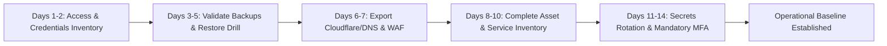
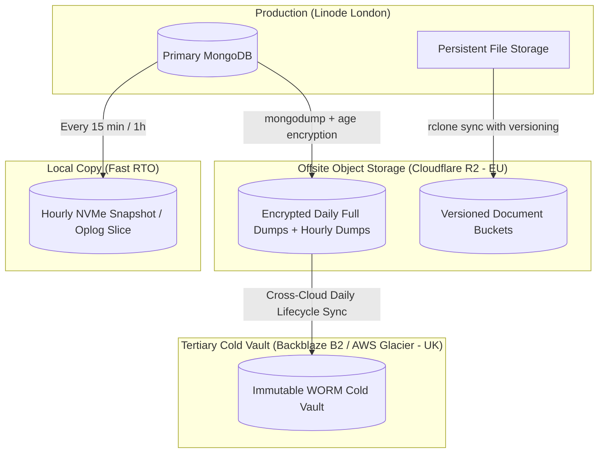
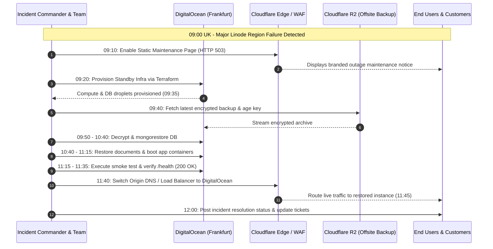
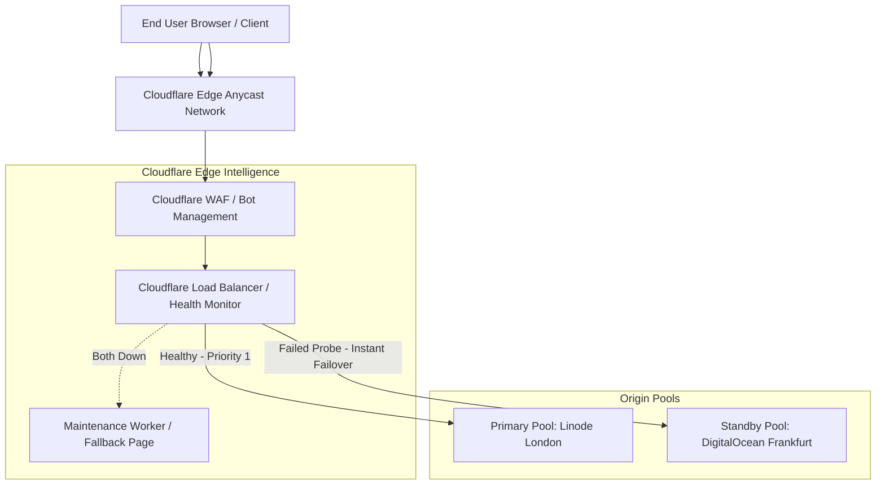

# Part 2: Strategic Architectural & Operational Plan ("Think")
**Organization:** Study Now Limited  
**Prepared by:** Abhishek Goswami  
**Role:** Senior DevOps / SRE Engineer  

---

## 1. The First Two Weeks: Operational Priorities & Sequencing

When taking ownership of an existing production environment, operational stability and business continuity take precedence over premature modernization. Sequencing must follow a risk-reduction hierarchy: you cannot safely change an environment until you know who has access, that your backups actually restore, and that edge routing is preserved.



### Day 1–2: Access and Credentials Inventory
* **Objective:** Discover all administrative paths, human users, service accounts, and API tokens across Linode, Cloudflare, GitHub, database layers, and third-party SaaS.
* **Actions:**
  1. Enumerate all identity directories, SSH keys on running nodes (`~/.ssh/authorized_keys`), and Linode API tokens.
  2. Audit sudoers and container host access.
  3. Identify orphaned contractors, former employees, or shared generic logins (`admin@`, `support@`).
* **Why first:** Any subsequent change is vulnerable if unauthorized actors or unmanaged credentials retain access to the control plane.

### Day 3–5: Confirm Backups Exist and Can Actually Restore
* **Objective:** Verify disaster recovery viability *before* making any infrastructure alterations.
* **Actions:**
  1. Inspect automated backup schedules for databases (MongoDB) and object storage (uploaded documents).
  2. Pull the most recent backup into an isolated sandbox environment.
  3. Execute an end-to-end restore drill, recording the exact Recovery Time Objective (RTO) and verifying data integrity.
* **Why second:** "An untested backup does not exist." If existing automated backups are silently failing or corrupt, discovering this during a crisis is fatal.

### Day 6–7: Cloudflare, DNS, and Edge/WAF State Export
* **Objective:** Snapshot the edge ingress layer and establish state configuration backups.
* **Actions:**
  1. Export zone files (all BIND DNS records), Cloudflare WAF custom firewall rules, rate limits, Page Rules, and SSL/TLS cipher configurations.
  2. Store exported configurations in version control (`git`).
  3. Review TTL settings across public domains to prepare for agile failover.
* **Why third:** DNS and edge routing govern all ingress traffic. If cloud credentials or VMs fail, edge routing is the steering mechanism used for disaster recovery.

### Day 8–10: Infrastructure Asset and Dependency Inventory
* **Objective:** Catalog the entire running topology, networking, and dependencies.
* **Actions:**
  1. Map all running Linode compute instances, volumes, VPC/private networks, MongoDB nodes, and file stores.
  2. Map external SaaS dependencies (transactional email, SMS, payment gateways, analytics, webhook endpoints).
  3. Identify unmonitored resources, zombie instances, and compute sizing bottlenecks.

### Day 11–14: Secrets Rotation and Organization-Wide MFA Enforcement
* **Objective:** Eliminate credential sprawl and enforce modern authentication standards.
* **Actions:**
  1. Enforce hardware security key (FIDO2/WebAuthn) or TOTP MFA across all administrative portals (Linode, Cloudflare, GitHub, AWS/GCP). Disable SMS-based 2FA.
  2. Systematically rotate database master passwords, application JWT signing keys, and external API tokens.
  3. Establish a centralized secrets manager (e.g., HashiCorp Vault or Cloudflare Secrets) rather than unencrypted `.env` files scattered on disks.

### What Is Deliberately Postponed
During the first two weeks, the following activities are strictly postponed:
1. **Application Code Refactoring & Framework Upgrades:** Changing business logic or runtime versions introduces untracked regression risks before monitoring baselines exist.
2. **Database Engine Migrations:** Moving from MongoDB to PostgreSQL or changing database clustering models is high-risk and requires extensive pre-planning.
3. **Container Orchestration Shifts (e.g., moving to Kubernetes):** If the application runs reliably on Docker Compose / standalone VMs, migrating to Kubernetes adds cognitive overhead before foundational operational observability is solid.
4. **Tool Sprawl & CI/CD Tool Re-architecture:** Adopting new monitoring platforms before stabilizing current metrics wastes critical runway.

---

## 2. Resilient 3-2-1 Backup Design

A robust backup architecture guarantees recovery under ransomware attacks, accidental deletion, and total cloud provider outages.



### 3-2-1 Rule Implementation Details
1. **3 Copies of Data:**
   - **Copy 1 (Operational Primary):** Live MongoDB cluster and local persistent volume on Linode NVMe storage.
   - **Copy 2 (Local Fast-Recovery Secondary):** On-host / local private network hourly compressed snapshots and oplog tail for instant recovery from human error.
   - **Copy 3 (Off-site Encrypted Archive):** Geographically isolated, encrypted object storage in Cloudflare R2 (Amsterdam/Frankfurt) and cold replica in Backblaze B2 (UK).
2. **2 Different Storage Media Types:**
   - **Media 1:** Block Storage / High-Performance NVMe SSD (Local Linode volumes).
   - **Media 2:** S3-compatible Object Storage (Cloudflare R2 and Backblaze B2 WORM storage).
3. **1 Off-site Copy:**
   - Cloudflare R2 / Backblaze B2 situated outside the primary provider's physical data center network, ensuring zero shared fate with Linode.

### Meeting the 1-Hour Recovery Point Objective (RPO)
To guarantee that at most 1 hour of data can ever be lost:
* **MongoDB (Transactional Data):**
  - Continuous incremental backup using MongoDB oplog archiving every 15 minutes, coupled with hourly compressed `mongodump` snapshots.
  - Slices are immediately encrypted client-side using `age` (via public key) and streamed to Cloudflare R2 over HTTPS.
* **Uploaded Documents & Attachments:**
  - Application files are written to an S3-compatible bucket or synced directory.
  - Bucket Object Versioning is enabled to protect against ransomware encryption and accidental deletions.
  - Continuous near-real-time bidirectional replication or hourly `rclone sync` to secondary bucket with Object Lock (WORM: Write Once, Read Many) retention for 30 days.

### Backup Topologies & Monthly Cost Estimate

| Tier | Purpose | Media / Provider | Frequency | Retention | Est. Size | Est. Monthly Cost (USD) |
| :--- | :--- | :--- | :--- | :--- | :--- | :--- |
| **Primary** | Live production | Linode NVMe Block Storage | Realtime | Current | 100 GB | Included in VM ($20/mo) |
| **Secondary**| Local fast restore | Linode Backup Service / Snapshot | Hourly / Daily | 7 Days | 100 GB | $5.00 / mo |
| **Offsite** | Primary DR storage | Cloudflare R2 (Zero Egress fees) | Hourly dumps + Sync | 30 Days | 300 GB | $4.50 / mo ($0.015/GB, $0 egress) |
| **Cold Vault**| Compliance / Ransomware | Backblaze B2 (Object Lock enabled) | Daily Sync | 90 Days | 500 GB | $3.00 / mo ($0.006/GB) |
| **Total** | | | | | | **~$12.50 / mo** (Excl. base compute) |

*Key economic benefit:* Cloudflare R2 charges **$0.00 for data egress**, enabling frequent disaster recovery drills without budget penalties.

---

## 3. Linode Region Catastrophic Outage (09:00 UK): 4-Hour Recovery Walkthrough

*Scenario:* At 09:00 UK time, Linode's London data center suffers a major power and network failure. Internal Linode status reports an unknown ETA for recovery.



### Detailed Timeline:

#### 09:00 – 09:15: Incident Declaration, War Room, and Scope Confirmation
* **09:02:** Automated health monitoring alerts fire in Slack (`🚨 CRITICAL: Study Now API Unreachable - HTTP 000`).
* **09:05:** Incident Commander (IC) declares a **SEV-1 Critical Outage** and opens an incident bridge/Slack war room (`#inc-202611-linode-outage`).
* **09:08:** IC verifies external reachability and checks Linode status page. Confirms widespread regional power loss with no resolution ETA.
* **09:12:** **Public Communication Step 1:** Update public status page (Statuspage / Instatus) to *"Investigating service disruption"*.
* **09:14:** IC enacts the Multi-Cloud Disaster Recovery Plan, targeting the pre-configured standby cloud: **DigitalOcean (Frankfurt / AMS)**.

#### 09:15 – 09:45: Secondary Cloud Infrastructure Provisioning
* **09:16:** Direct Cloudflare edge to serve the **Pre-configured Maintenance Page Worker** immediately, returning friendly branded maintenance status with HTTP 503 so traffic does not show raw gateway timeouts.
* **09:20:** SRE executes the Terraform DR module from local workstation / GitHub Actions:
  ```bash
  cd terraform/environments/disaster-recovery
  terraform apply -auto-approve -var="region=fra1"
  ```
* **09:35:** DigitalOcean infrastructure is ready:
  - 1x Droplet: Compute Host (Docker, Docker Compose, Nginx)
  - 1x Managed MongoDB or Droplet volume with Dockerized MongoDB
  - Private VPC and firewall rules applied.

#### 09:45 – 10:45: Database Restoration & Point-in-Time Recovery
* **09:47:** Retrieve `age` private disaster recovery key from secure offline vault (e.g., 1Password Emergency Kit / HashiCorp Vault break-glass).
* **09:50:** Stream the latest encrypted backup directly from Cloudflare R2 into the secondary database instance:
  ```bash
  aws s3 cp s3://studynow-backups/backups/latest.dump.gz.age - \
    --endpoint-url https://<id>.r2.cloudflarestorage.com | \
    age -d -i keys/age.key | \
    mongorestore --username admin --password $PASS --archive --gzip --drop
  ```
* **10:35:** `mongorestore` finishes. Database integrity check executes:
  - Collection counts verified against backup metadata log.
  - Index rebuilding confirmed.
  - Application user `conduit_user` permissions verified.
* **10:45:** Database is online, seeded, and ready for queries.

#### 10:45 – 11:30: Document Storage Sync & Application Bootstrap
* **10:48:** Initiate rapid sync of user-uploaded files from Cloudflare R2 to DigitalOcean persistent storage volume:
  ```bash
  rclone sync r2:studynow-documents /mnt/data/uploads --transfers=16 --checkers=32
  ```
* **11:05:** Deploy application container stack on secondary host:
  ```bash
  docker compose -f docker-compose.prod.yml up -d
  ```
* **11:15:** Verify app containers pass local container healthchecks (`curl -f http://localhost:3000/health`).

#### 11:30 – 12:00: Verification, Smoke Testing & Cloudflare Traffic Cutover
* **11:32:** Execute end-to-end smoke test suite against secondary host via temporary staging header (`X-Bypass-Maintenance: true`):
  - User authentication / login.
  - Article creation and retrieval.
  - Document download integrity.
  - Zero database connectivity latency.
* **11:42:** **DNS & Traffic Cutover:** Update Cloudflare Origin IP or flip Cloudflare Load Balancer Active Pool from `Linode-London-Pool` to `DigitalOcean-Frankfurt-Pool`.
* **11:45:** Cloudflare edge begins proxying live user traffic to DigitalOcean.
* **11:55:** Inspect live access logs; confirm HTTP 200/201 responses; error rate drops to < 0.01%.

#### 12:00 – 13:00: Post-Recovery Communication & Stability Monitoring
* **12:05:** **Public Communication Step 2:** Update status page to *"Resolved: All services operational under disaster recovery standby"*.
* **12:15:** Notify internal stakeholders, academic partners, and operations team via email.
* **12:30:** Monitor error rates, latency percentiles (p95, p99), and CPU/memory utilization on new infrastructure.
* **13:00:** SEV-1 bridge closed. Schedule formal Post-Mortem / Incident Review meeting for next working day.

---

## 4. Month-One Cloudflare & Edge DNS Modernization

To transition from manual emergency failovers to automated, resilient zero-downtime routing, execute the following modernizations during Month One:



### 1. TTL Reduction & Propagation Optimization
* **Action:** Lower DNS record Time-To-Live (TTL) values from default (86400s / 1 day) to **120 seconds** (or "Auto" when proxied through Cloudflare).
* **Rationale:** Cloudflare's Anycast proxy handles public routing instantly. If direct DNS updates are required (e.g. for non-proxied subdomains), a 2-minute TTL prevents stale ISP caching during an emergency migration.

### 2. Cloudflare Load Balancing with Automatic Health-Checked Failover
* **Configuration:**
  - Create **Origin Pool 1 (Primary - Linode London)** and **Origin Pool 2 (Secondary - DigitalOcean)**.
  - Configure automated Health Monitors probing `GET /health` every 15 seconds across multiple geographic probes (London, Amsterdam, Frankfurt).
  - Set failover threshold to 2 consecutive failures with 5-second timeouts.
  - When Linode fails health checks, Cloudflare re-routes 100% of ingress requests to DigitalOcean within **30 seconds with zero manual intervention**.

### 3. DNS-as-Code via Terraform
* **Action:** Manage 100% of DNS, WAF rules, and load balancers through declarative Terraform code stored in git:
  ```hcl
  resource "cloudflare_load_balancer" "app_lb" {
    zone_id          = var.cloudflare_zone_id
    name             = "api.studynow.org.uk"
    fallback_pool_id = cloudflare_load_balancer_pool.standby_pool.id
    default_pool_ids = [
      cloudflare_load_balancer_pool.primary_pool.id,
      cloudflare_load_balancer_pool.standby_pool.id
    ]
    steering_policy  = "dynamic_latency"
    proxied          = true
  }
  ```
* **Benefits:** Every DNS record change is peer-reviewed in pull requests, fully auditable, and reproducible in minutes.

### 4. Edge-Rendered Maintenance Page (Zero-Origin Dependency)
* **Implementation:** Deploy a Cloudflare Worker that intercepts 502/503/504 origin errors or activates when a global toggle is switched.
* **Features:**
  - Emits HTTP 503 (Service Unavailable) so search engines don't de-index URLs.
  - Fully self-contained HTML/CSS/SVG with Study Now branding, status page live embed, and helpdesk contact details.
  - Served directly from Cloudflare's 300+ Edge Anycast points even if all backend cloud providers are completely offline.

### 5. Pre-Warmed Standby Architecture
* Rather than cold provisioning during an outage, maintain a minimal "Warm Standby" instance in the secondary region:
  - Small shared Droplet ($12/mo) running MongoDB secondary replica or continuous receiver.
  - Docker images pre-pulled from GHCR on the standby host so deployment starts in seconds rather than waiting for multi-gigabyte downloads.
  - Keeps RTO under **3 minutes** instead of hours.
