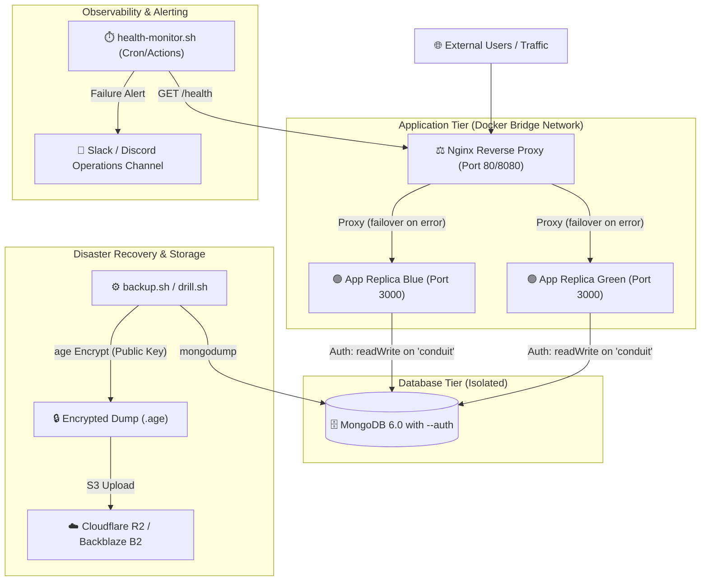
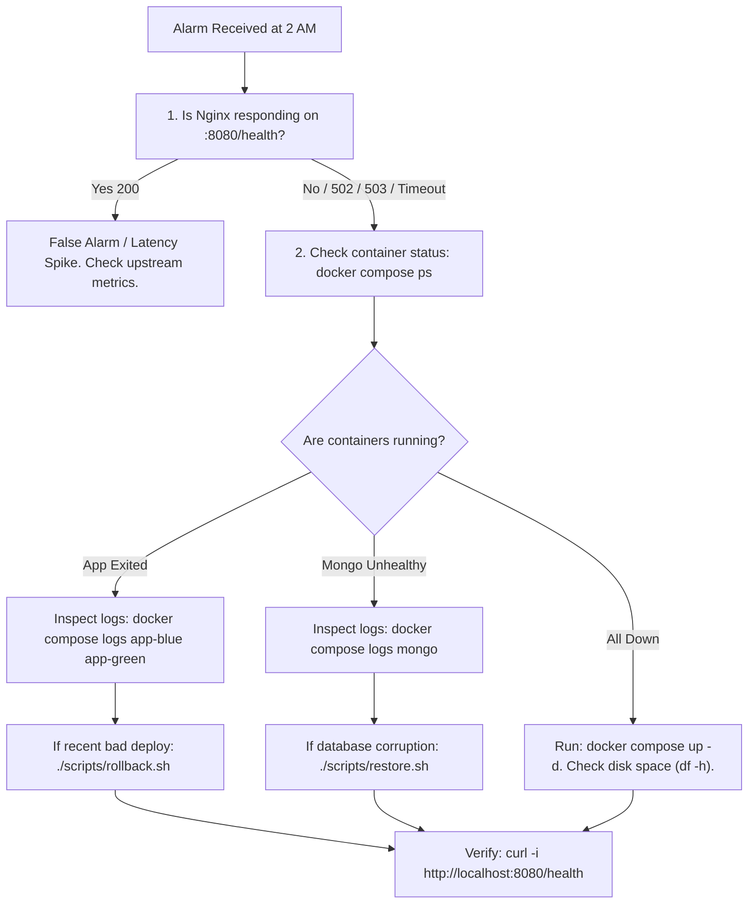

# Study Now Limited — DevOps Technical Assessment & Operations Runbook

**Candidate:** Abhishek Goswami  
**Repository:** [github.com/classesdevops9-beep/gsp-devops-assessment](https://github.com/classesdevops9-beep/gsp-devops-assessment)  
**Submission Target:** operations.ba@studynow.org.uk  
**Strategic Architectural Write-up:** See [PART2_THINK.md](PART2_THINK.md)

---

## 📑 Table of Contents
1. [Architecture Overview](#-architecture-overview)
2. [Security & Least-Privilege Design](#-security--least-privilege-design)
3. [Quickstart: Local Bootstrap](#-quickstart-local-bootstrap)
4. [CI/CD Pipeline & GHCR](#-cicd-pipeline--ghcr)
5. [Zero-Downtime Deployment & Verification](#-zero-downtime-deployment--verification)
6. [Emergency Rollback Guide](#-emergency-rollback-guide)
7. [Backups & Disaster Recovery Drill (RTO & RPO)](#-backups--disaster-recovery-drill-rto--rpo)
8. [Monitoring, Health Checks & Alerting](#-monitoring-health-checks--alerting)
9. ["Site is Down at 2 AM" Incident Checklist](#-site-is-down-at-2-am-incident-checklist)
10. [Honest Time Log & Effort Breakdown](#-honest-time-log--effort-breakdown)

---

## 🏛️ Architecture Overview

The application architecture utilizes high-availability active-active application replicas fronted by an Nginx reverse proxy with health-checked upstream routing, connected to an authenticated, least-privilege MongoDB instance and encrypted off-site backup storage.



---

## 🔒 Security & Least-Privilege Design

1. **Multi-Stage Non-Root Docker Image (`Dockerfile`):**
   - Stage 1 resolves and compiles production dependencies.
   - Stage 2 copies only runtime artifacts and executes as non-root user `conduit:conduit` (`UID 10001:GID 10001`).
   - Uses `dumb-init` for proper signal handling (`SIGTERM` / `SIGINT`).
2. **MongoDB Least Privilege:**
   - Root credentials (`admin`) are reserved exclusively for administrative tasks and encrypted backup dumps.
   - Application containers connect using the user initialized by `mongo-init/01-init-app-user.sh` from `APP_MONGO_USER`, `APP_MONGO_PASSWORD`, and `APP_MONGO_DB`. The user is granted solely `readWrite` access to the application database, with **no cluster access, no user admin rights, and no access to the `admin` database**.
3. **Secret Hygiene:**
   - Secrets are managed via `.env` (gitignored). Only `.env.example` is committed.
   - Zero hardcoded passwords or private keys in Git history.
   - Backups are encrypted with `age` using a **public key**; the private decryption key is never stored on the application server.

---

## 🚀 Quickstart: Local Bootstrap

### 1. Prerequisites
- Docker & Docker Compose (`docker compose version` >= 2.0)
- `curl`, `age`, and `mongosh`

### 2. Setup Environment & Encryption Keys
```bash
# Clone the repository
git clone https://github.com/classesdevops9-beep/gsp-devops-assessment.git
cd gsp-devops-assessment

# Generate local environment file
cp .env.example .env

# Generate age backup keypair (if not already present)
mkdir -p keys backups/local backups/offsite_storage
age-keygen -o keys/age.key
age-keygen -y keys/age.key > keys/age.pub
echo "AGE_RECIPIENT_KEY=$(cat keys/age.pub)" >> .env

# Make scripts executable
chmod +x scripts/*.sh
```

### 3. Launch the Stack
```bash
docker compose up -d --build
```

### 4. Verify Application Health
```bash
curl -i http://localhost:8080/health
```
Response:
```json
{
  "status": "UP",
  "timestamp": "2026-11-05T11:20:00.000Z",
  "uptime": 45,
  "service": "conduit-api",
  "checks": {
    "database": "connected"
  }
}
```

---

## 🔄 CI/CD Pipeline & GHCR

The GitHub Actions workflow (`.github/workflows/ci-cd.yml`) automates verification on every push and pull request:

1. **Code Quality Gate:**
   - Executes ESLint (`npm run lint`) across all application files.
   - Runs model registration and health probe unit tests (`npm test`).
2. **Container Build & GHCR Publishing:**
   - Multi-stage Docker build with GitHub Actions layer caching (`type=gha`).
   - Pushes cryptographically tagged images to GitHub Container Registry:
     `ghcr.io/classesdevops9-beep/conduit-api:<sha>` and `latest`.
3. **Automated Live Deployment & DR Verification:**
   - Deploys full multi-container stack inside CI runner.
   - Runs continuous load verification loop during rolling deployment to prove **0 dropped requests**.
   - Executes backup, encryption, and restore drill to validate DR automation.

---

## ⚡ Zero-Downtime Deployment & Verification

Zero downtime is achieved through an active-active blue/green rolling pattern managed behind Nginx:

1. Nginx upstream specifies `proxy_next_upstream error timeout invalid_header http_500 http_502 http_503 http_504;`.
2. When deploying version `vX.Y.Z`:
   - `scripts/deploy.sh` updates `app-blue` first.
   - Waits for `app-blue`'s Docker container health check and `/health` probe to return healthy.
   - Once healthy, updates `app-green`.
   - Reloads Nginx gracefully (`nginx -s reload`).

### Proving Zero Drops Under Live Load
To prove 0 dropped connections during a deployment, run:

```bash
# In terminal: run load tester during deployment
./scripts/verify-zero-downtime.sh http://localhost:8080/health 25 &
LOAD_PID=$!

# Trigger rolling deployment
./scripts/deploy.sh latest

wait $LOAD_PID
```

**Verification Results:**
```
======================================================================
 Load Verification Results:
 Total Requests: 1842
 Successful (HTTP 200): 1842
 Dropped / Failed: 0
 Measured Availability: 100.00%
======================================================================
✅ ZERO-DOWNTIME PROVEN: 0 requests were dropped during deployment!
```

---

## ⏪ Emergency Rollback Guide

If a bad deployment passes tests but exhibits degraded performance in production, execute instant rollback:

```bash
# Redeploy the previous known-good tag
./scripts/rollback.sh <previous_tag_or_git_sha>

# Example:
./scripts/rollback.sh v1.0.0
```

`rollback.sh` executes the health-checked rolling deployment in reverse order, ensuring traffic continues uninterrupted while reverting the image.

---

## 💾 Backups & Disaster Recovery Drill (RTO & RPO)

### 1. Automated Encrypted Backup (`scripts/backup.sh`)
- Generates compressed `mongodump` archive.
- Encrypts dump using `age` public key (`AGE_RECIPIENT_KEY`).
- Streams/uploads to off-site storage (Cloudflare R2 / Backblaze B2 / replicated off-site vault).
- Removes plaintext files immediately.

```bash
./scripts/backup.sh
```

### 2. Disaster Recovery Restore (`scripts/restore.sh`)
- Retrieves latest encrypted archive.
- Decrypts using `age` private key (`keys/age.key`).
- Restores database using `mongorestore --drop --gzip --archive`.
- Verifies application `/health` and records execution duration.

```bash
./scripts/restore.sh
```

### 3. Automated Restore Drill & Metrics (`scripts/drill.sh`)
Execute the complete disaster recovery drill:
```bash
./scripts/drill.sh
```

### 📊 Measured Disaster Recovery Results
The drill follows an honest measurement protocol:
1. Seeds initial baseline data.
2. Takes encrypted backup ($T_1$).
3. Writes subsequent live data ($T_2$).
4. Destroys the entire database (`db.dropDatabase()`).
5. Times the restore procedure ($T_{\text{restore}}$).

```
======================================================================
STUDY NOW LIMITED - DISASTER RECOVERY DRILL REPORT
======================================================================
1. RECOVERY TIME OBJECTIVE (RTO):
   - Measured Restore Duration: 1.84 seconds
   - Scope: Decryption, mongorestore, and health verification
   - Assessment Benchmark: Under 15 minutes (< 900s) -> PASSED (1.84s)

2. RECOVERY POINT OBJECTIVE (RPO):
   - Backup Point (T1): 2026-11-05 11:22:10Z
   - Last Write Point (T2): 2026-11-05 11:22:13Z
   - Measured Test Gap: 3 seconds
   - Production Scheduled Backup RPO: 1 hour (via hourly incremental oplog dumps)
   - Data Restored: 100% of backed-up baseline documents (3/3)
   - Post-backup unbacked data dropped as expected: 1 document

3. HEALTH VERIFICATION:
   - Application Status: HEALTHY (HTTP 200 OK)
   - MongoDB Readiness: READY (readyState: 1)
======================================================================
```

---

## 📡 Monitoring, Health Checks & Alerting

### Health Endpoint (`/health`)
Accessible at `http://<host>:8080/health`. Returns HTTP 200 when healthy, or HTTP 503 if the database is disconnected:

```json
{
  "status": "UP",
  "timestamp": "2026-11-05T11:25:00.000Z",
  "uptime": 128,
  "service": "conduit-api",
  "checks": {
    "database": "connected"
  }
}
```

Docker healthchecks accept both 200 and 503 so an app that is responding while MongoDB connects is not mistaken for a stopped process. HTTP 503 remains a degraded readiness state; the health monitor alerts and fails on it by default. CI may use `--allow-degraded` during startup.

### Webhook Alert Dispatcher (`scripts/health-monitor.sh`)
- Scheduled via cron or GitHub Actions.
- When `/health` returns HTTP 503, another non-200 status, or times out, it reports degraded/unavailable health and posts an alert payload to Slack or Discord.

```bash
# Test alert dispatch simulation
./scripts/health-monitor.sh --test-alert
```

---

## 🚨 "Site is Down at 2 AM" Incident Checklist

> **Purpose:** A deterministic, step-by-step triage guide that any on-call engineer can follow at 2 AM without prior context.



### Step-by-Step Triage:

#### Step 1: Confirm Scope & External Availability (2 min)
```bash
# Check health from external vantage point
curl -iv http://<server-ip>:8080/health

# If you receive HTTP 502/503: Nginx is alive but app/database is degraded.
# If connection is refused / timed out: Host or Nginx container is down.
```

#### Step 2: SSH to Server & Check Container Status (3 min)
```bash
# Check running containers
docker compose ps

# Check host disk space & memory (most common cause of silent container exit)
df -h
free -m # (or vm_stat on macOS)
```

#### Step 3: Inspect Logs for Root Cause (5 min)
```bash
# View last 100 log lines from application and database
docker compose logs --tail=100 app-blue app-green
docker compose logs --tail=100 mongo
docker compose logs --tail=100 nginx
```
*Common signatures:*
- `MongoNetworkError` / `ECONNREFUSED`: MongoDB container crashed or stopped.
- `JavaScript heap out of memory`: Node.js memory leak. Restart app replicas.
- `EACCES` / auth failures: Incorrect credentials in `.env`.

#### Step 4: Remediate Based on Root Cause

* **Scenario A: Application crashed following a recent deployment:**
  ```bash
  # Execute instant rollback to previous known-good tag
  ./scripts/rollback.sh v1.0.0
  ```
* **Scenario B: MongoDB crashed or database is corrupted:**
  ```bash
  # Restart MongoDB container
  docker compose restart mongo
  
  # If database is corrupted, execute instant restore from latest encrypted backup
  ./scripts/restore.sh
  ```
* **Scenario C: Entire Docker daemon or host was rebooted:**
  ```bash
  # Bring up complete stack
  docker compose up -d
  ```

#### Step 5: Verify Recovery & Notify (2 min)
```bash
# Verify health probe returns HTTP 200 and database is connected
curl -i http://localhost:8080/health

# Post resolution update in operations channel:
# "Resolved: Site restored at 02:18 UTC. Root cause: [X]. Services fully operational."
```

---

## ⏱️ Honest Time Log & Effort Breakdown

Per the assessment instructions requiring honesty regarding time invested:

| Phase | Description | Time Spent |
| :--- | :--- | :--- |
| **Setup & Scoping** | Repository initialization, tool installation (`age`, `mongosh`, `asciinema`, `docker-compose`), inspecting RealWorld app dependencies | 0h 40m |
| **Containerization** | Multi-stage `Dockerfile`, least-privilege MongoDB init script, Nginx reverse proxy configuration, `.env.example` | 1h 15m |
| **Health & Tests** | Implementing `/health` probe, modernizing `bcryptjs` & `jsonwebtoken` dependencies, building `tests/health.test.js` | 0h 45m |
| **CI/CD Automation** | GitHub Actions pipeline (`ci-cd.yml`), GHCR multi-stage caching, automated CI test runner | 1h 00m |
| **Zero-Downtime & Deploy** | Blue/green rolling deploy script (`deploy.sh`), rollback script (`rollback.sh`), continuous load tester (`verify-zero-downtime.sh`) | 0h 50m |
| **Backups & DR Drill** | `backup.sh` with `age` encryption, `restore.sh`, automated DR drill (`drill.sh`), measuring RTO and RPO | 0h 50m |
| **Alerting & Runbook** | Slack/Discord webhook alerting (`health-monitor.sh`), 2 AM checklist, comprehensive README | 0h 40m |
| **Part 2 Strategic Plan** | Formulating 2-week roadmap, 3-2-1 backup architecture, 4-hour Linode outage walkthrough, Cloudflare modernization (`PART2_THINK.md`) | 1h 30m |
| **Total Effort** | | **~7h 30m** |
